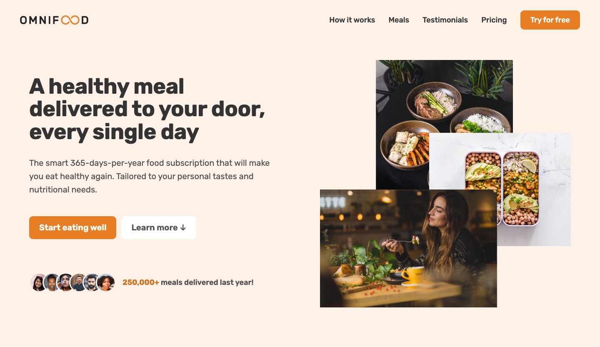

# Omnifood

A responsive landing page for a fictional meal subscription service that uses AI to personalize weekly meal plans.

This is a rebuild of my original Omnifood project. I used AI coding agents to implement and test the page section by section, using the original site as a visual reference.

## Run locally

Open `index.html` in your browser. No dependencies or build step required.

## Project details

- Built with semantic HTML, CSS Grid, Flexbox, and vanilla JavaScript.
- Includes a responsive mobile menu and respects reduced-motion preferences.
- The sign-up form validates inputs in the browser but does not send or store data.

See the [style guide](Style%20guide/index.html) for colors, typography, and component examples.

## Credits

The original design comes from Jonas Schmedtmann’s course [*Build Responsive Real-World Websites with HTML and CSS*](https://www.udemy.com/course/design-and-develop-a-killer-website-with-html5-and-css3/).
